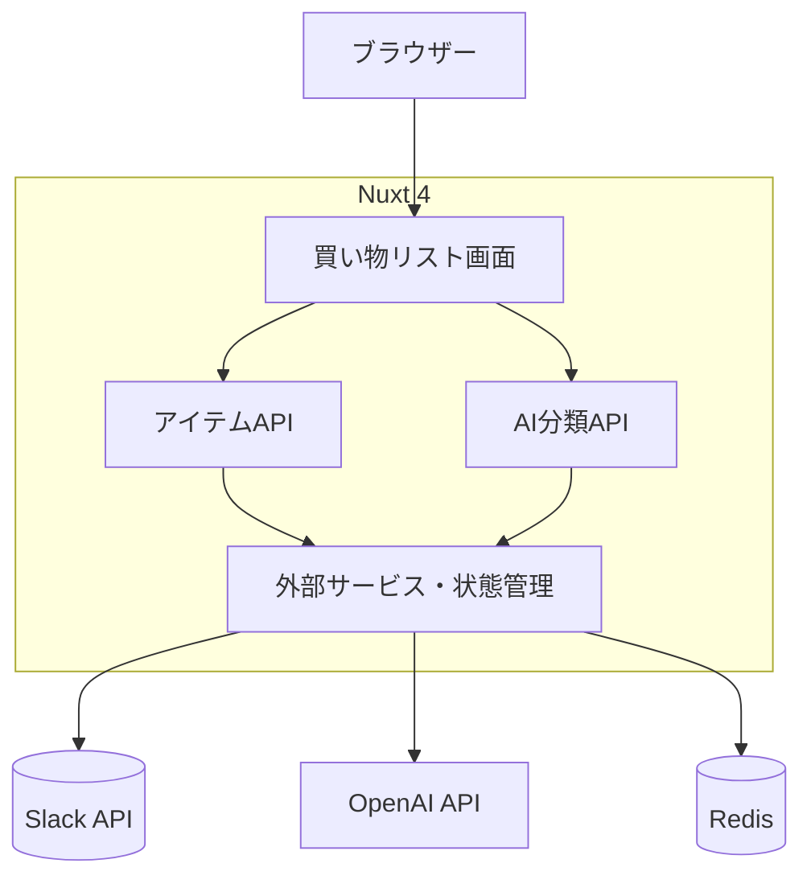

# Slack連動買い物リスト

Slackの指定チャンネルへの投稿を「1投稿＝1アイテム」として扱う、スマートフォン向けの買い物リストです。

## 主な機能

- Slackの未購入アイテムを投稿日時の昇順で表示
- 画面から新しいアイテムをSlackへ投稿
- 購入済みアイテムへ`:heavy_check_mark:`リアクションを追加
- 定期取得による複数利用者間の状態同期
- OpenAI APIによる陳列カテゴリー分類
- Redisによるアイテム名ごとのAI分類結果の保存

## 構成

Nuxt 4のSSRサーバーとAPIを一つのアプリケーションとして動かし、Slack API、OpenAI API、Redisと連携します。



Slackをアイテムのデータストアとして利用します。購入前のチェック状態はNuxtサーバーのメモリーに一時保存し、AI分類結果はRedisへ保存します。

## 事前準備

### Slackアプリ

Slackアプリへ次のBot Token Scopesを設定し、対象チャンネルへ追加します。

- `channels:history`: パブリックチャンネルの投稿取得
- `groups:history`: プライベートチャンネルを使う場合の投稿取得
- `chat:write`: 画面からのアイテム投稿
- `reactions:write`: 購入済みリアクションの追加
- `users:read`: 投稿者名の取得

Bot User OAuth Tokenと対象チャンネルIDを控えてください。

### OpenAI API

OpenAI APIキーを用意してください。

## 環境変数

`.env.example`を基に`.env`を作成します。`.env`は機微情報を含むため、リポジトリーへ追加しないでください。

主な設定値は次のとおりです。

- `NUXT_SLACK_BOT_TOKEN`: Slack Bot User OAuth Token
- `NUXT_SLACK_CHANNEL_ID`: 対象チャンネルID
- `NUXT_OPENAI_API_KEY`: OpenAI APIキー
- `NUXT_OPENAI_MODEL`: 分類に使うモデル
- `NUXT_CATEGORIES`: 陳列順のカテゴリー一覧
- `NUXT_REDIS_URL`: Redis接続先

## 開発環境

パッケージ管理ツールとサーバーは、すべてコンテナー内で実行します。

初回起動時や`package.json`の変更後は、開発用イメージを再構築します。

```bash
docker compose build app
docker compose up
```

起動後は[http://localhost:3000](http://localhost:3000)へアクセスします。

パッケージを追加する場合もコンテナー内で実行します。

```bash
docker compose run --rm app npm install <package-name>
```

## 検証

```bash
docker compose exec app npm run lint
docker compose exec app npx nuxt typecheck
docker compose exec app npm run build
```

## 本番用イメージ

```bash
docker build -t shopping-list-production --target production .
docker run -d -p 3000:3000 --env-file .env --name shopping-list-production shopping-list-production
```

本番環境では、`NUXT_REDIS_URL`から接続できるRedisが別途必要です。
