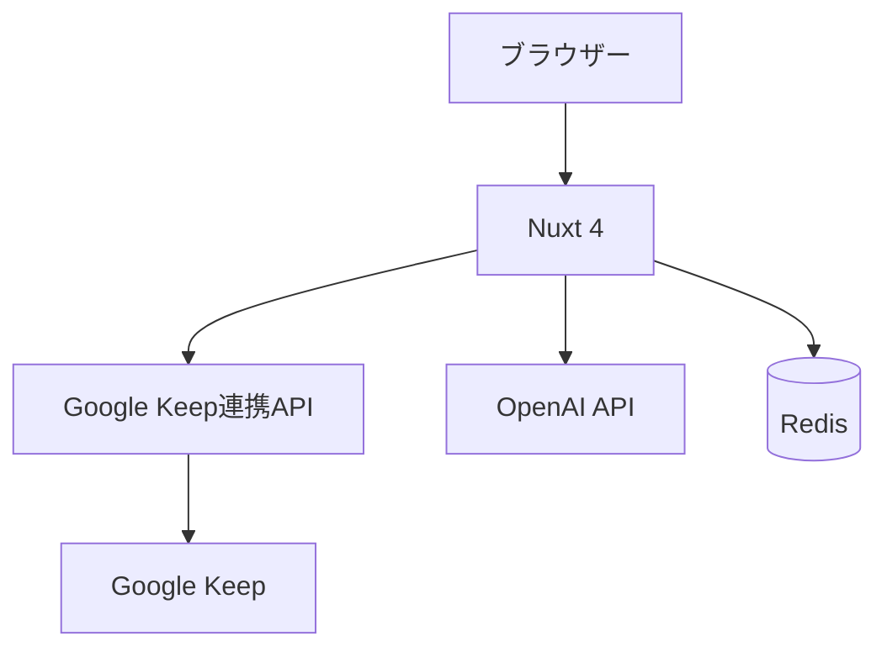

# Google Keep連動買い物リスト

Google Keepの指定リストを正本として使う、スマートフォン向けの買い物リストです。

## 主な機能

- Google Keepの未購入アイテムを表示
- 画面とGoogle Keepの双方向同期
- OpenAI APIによる陳列カテゴリー分類
- Redisによる分類結果の保存

## 構成

Nuxt 4とGoogle Keep連携APIは、所有範囲と実行環境が異なるため別コンテナーで動かします。



- `app/`、`server/`: Nuxtの画面とAPI
- `keep-api/`: Google Keepだけを扱うPython API
- Redis: アイテム名ごとのAI分類結果

画面で選択した状態はNuxtサーバーのメモリーへ一時保存し、「購入済み」の確定時にGoogle Keepへ反映します。

## 事前準備

`.env.example`を`.env`へ複製し、OpenAI、カテゴリー、Redisの設定を入力します。

Google Keep用のマスタートークンと端末IDは、次の手順で発行します。

1. [Google Embedded Setup](https://accounts.google.com/EmbeddedSetup)をブラウザーで開きます。
2. Googleアカウントへログインし、確認画面で同意します。
3. 読み込み中のままでも、ブラウザーの開発者ツールを開きます。
4. `https://accounts.google.com`のCookieから`oauth_token`の値を取得します。
5. 次のコマンドを実行し、メールアドレスと`oauth_token`を入力します。

```bash
docker compose run --rm keep-api python3 get_master_token.py
```

`oauth_token`はパスワードと同様に扱い、保存や共有をしないでください。

表示された次の値を`.env`へ設定します。

- `KEEP_EMAIL`: Googleアカウントのメールアドレス
- `KEEP_MASTER_TOKEN`: Google Keep接続用マスタートークン
- `KEEP_DEVICE_ID`: トークン発行時の端末ID
- `KEEP_LIST_TITLE`: 買い物リスト名
- `NUXT_KEEP_API_URL`: Nuxtから見たGoogle Keep連携APIのURL

マスタートークンと端末IDは組で使用します。どちらもリポジトリーへ追加しないでください。

## 開発環境

パッケージ管理ツールとシェルは、すべてコンテナー内で実行します。

```bash
docker compose build
docker compose up
```

起動後は[http://localhost:3000](http://localhost:3000)へアクセスします。

## 検証

```bash
docker compose exec app npm run lint
docker compose exec app npx nuxt typecheck
docker compose exec app npm run build
docker compose run --rm --no-deps keep-api python3 -m unittest -v test_main.py
```

## 本番用イメージ

GitHub Actionsは次の2イメージを同じ版で公開します。

- `ghcr.io/<owner>/<repository>:<tag>`: Nuxtアプリケーション
- `ghcr.io/<owner>/<repository>-keep-api:<tag>`: Google Keep連携API

本番環境では両イメージとRedisを同じネットワークへ配置し、Nuxtから`NUXT_KEEP_API_URL`でGoogle Keep連携APIを参照します。
